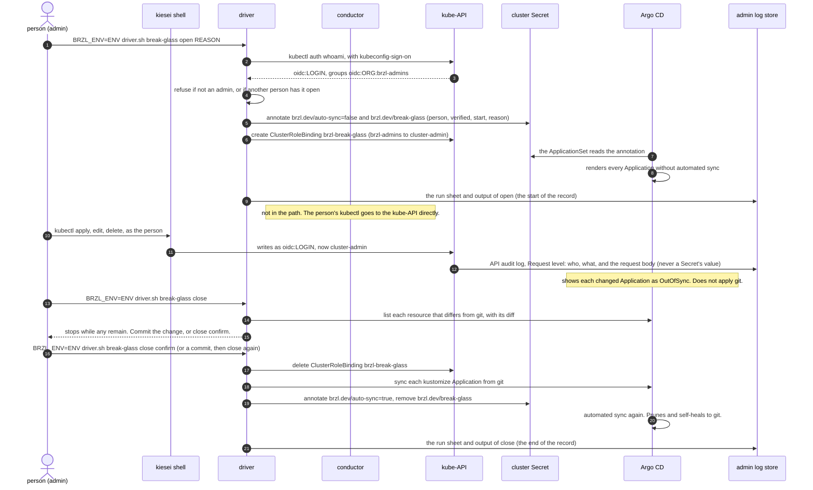

# Break-glass mode

Audience: an SRE who knows Kubernetes but has not seen this platform.
Companions: [SECURITY.md](SECURITY.md) (identities, the audit records),
[RECOVERY.md](RECOVERY.md) (when a recovery needs this mode),
[LOCAL.md](LOCAL.md) (`apply`, sign-on). The decision records are
[ADR-0037](adr/0037-break-glass-mode.md) and
[ADR-0038](adr/0038-driver-grammar.md).

**Status: built in pass 6b.** Step 1 (2026-10-27) has `open` and
`close`, the elevation, the audit rule and the alert. It also has
`as_admin` and `as_me` in the kiesei shell. Step 2 (2026-10-28) has the
reader of the admin log store. Item 37 (2026-11-05) gave the verbs their
names and made `apply` a break-glass verb. The vocabulary is the one of
[GLOSSARY.md](../GLOSSARY.md).

## What it is

In GitOps mode, a person does not change the cluster. The person changes
git, and Argo CD makes the cluster agree with the pushed branch. Argo CD
also undoes a change that somebody makes to a live object by hand.

Break-glass mode is the recorded exception. It is a mode of any
environment, for an emergency. In an emergency, the normal path is too
slow or does not work, and a person must change live objects now. While
the break-glass is open:

- Argo CD **pauses**: it stops automated sync for the whole environment.
- The admins get `cluster-admin` for the time it is open.
- Each admin acts with their own name, and the API audit log records
  what they changed.
- The start, the end and the reason are recorded in the admin log store,
  outside the cluster.
- A person reviews the record afterwards.

The driver's break-glass verbs are `open` (enter), `apply` (put a source
tree into the cluster, local only) and `close` (leave). The break-glass
of an environment is open once at a time.

Break-glass mode is also the developer's tool on local: `open`, then
`apply`, puts the working tree into the cluster for a change to the
structure of the cluster ([LOCAL.md](LOCAL.md), "Apply the working
tree"). That is not usual work either: `close` ends it. Break-glass mode
is for an emergency, and local is where you practise it.

## When to use it, and when not

Use break-glass mode when all of these are true:

- Something is broken or at risk now.
- The fix needs a change to live objects in the cluster.
- The normal path, a commit that Argo CD syncs, is too slow or does not
  work.

Examples:

- A sync deployed a broken chart, and the admin portal does not answer.
  A revert in git takes a review and a sync. The service must come back
  first.
- Argo CD itself is broken, for example its own configuration is gone.
  No commit can reach the cluster until Argo CD works again.
- A fix cannot wait for a commit. For example, a workload fills a disk,
  and you must scale it to zero now.

Do not use break-glass mode for:

- A normal change. Commit it, push it, and let Argo CD sync it.
- A long investigation that only reads. The `view` role reads the pods,
  the logs and the events of every namespace. You need no open
  break-glass to read.
- A change that Argo CD can do for you. An admin keeps `role:admin` in
  Argo CD at all times. Sync, refresh and a restart of a Deployment go
  through Argo CD's UI or CLI, with the break-glass closed.

If you are not sure, start to read with `view`. Open the break-glass only
when you know the change you must make.

## Where the pattern comes from

The names `open` and `close` are this platform's own (Q65, Q237): the
glass is open or closed. There is no standard pattern with these names.
Break-glass mode combines two established practices:

1. **Suspend GitOps reconciliation during an incident.** Flux has `flux
   suspend` and `flux resume`. Argo CD has two ways: turn automated sync
   off, or set a sync window of kind `deny`. This platform turns automated
   sync off for the whole environment, with one annotation (ADR-0025).
2. **Just-in-time (JIT) privileged access.** A person gets high rights
   for a limited time, for a stated reason, with a record. Examples:
   Microsoft Entra Privileged Identity Management, Google Cloud Privileged
   Access Manager, and the temporary elevated access of AWS IAM Identity
   Center. This platform gives the admins `cluster-admin` while the
   break-glass is open, with a record of the person and the reason.

The word "break-glass" comes from the fire alarm behind glass: the glass
is broken only in an emergency, and everybody can see that it was broken.

## What changes while the break-glass is open

| | Before `open` (GitOps mode) | While it is open | After `close` |
| --- | --- | --- | --- |
| Automated sync | On for every Application. Argo CD prunes and self-heals to git. | Off for every Application. Argo CD shows differences but does not apply git. | On again. Argo CD self-heals the cluster to git. |
| The admins' rights in Kubernetes | `view`, like operators and auditors. | `cluster-admin`, for the whole `brzl-admins` team. | `view` again. |
| The admins' rights in Argo CD | `role:admin` | `role:admin` (unchanged) | `role:admin` |
| `apply` (local) | Refused. | Available. | Refused. |
| The record | None. | The annotation `brzl.dev/break-glass` on the cluster Secret. The run sheet and output of `open` in the admin log store. The API audit log at Request level for the admins' writes. | The annotation is gone. The run sheet and output of `close` close the record. |

The mechanism, for the reader who wants it:

- `open` sets the annotation `brzl.dev/auto-sync: "false"` on the
  cluster Secret (`argocd/brzl-<env>-in-cluster`). This is the sync
  switch (ADR-0025). The platform ApplicationSet reads it and renders
  every Application without automated sync. Nothing in git changes.
- `open` adds a second annotation, `brzl.dev/break-glass`, with the
  person, whether the name is verified, the start time (UTC, ISO 8601
  with `Z`) and the reason.
- `open` creates a ClusterRoleBinding, `brzl-break-glass`, from the
  group `oidc:<org>:brzl-admins` to `cluster-admin`. Kubernetes does not
  let a binding change its `roleRef`, so this is a second binding beside
  the standing one, not an edit of it. `close` deletes it. Git does not
  manage this binding, so Argo CD does not remove it or bring it back.
- The standing binding of the admins, `brzl-tier-admins-view`, gives
  them `view` (`gitops/clusters/<env>/access/`). Until pass 6b it was
  `brzl-tier-admins`, with `cluster-admin` at all times. It has a new
  name, because the role of a binding cannot change.

## The procedure

Every command runs on the operator's machine, in the kiesei shell or
through `driver/kiesei.sh`. The kiesei shell is `bash driver/kiesei.sh
shell`. In it, `kubectl` is you: its kubeconfig is `kubeconfig-sign-on`,
and the shell signs you in through Dex when no session is cached.
`BRZL_ENV` names the environment. Without it, the driver takes `local`.

### Before you start

1. Make sure that you are a member of the `brzl-admins` team. `open`
   refuses every other person.
2. Make sure that you have a reason that you can write in one line. The
   reason goes into the record. Name the incident or the ticket.
3. Tell the other admins. While the break-glass is open, every admin has
   `cluster-admin`, and Argo CD does not sync for anybody.

### Enter

Sign in first, in the kiesei shell: `kubectl auth whoami` must name you.
`open` uses that session and does not open a browser itself.

```sh
BRZL_ENV=<env> bash driver/driver.sh break-glass open 'portal down after sync of chart X, INC-123'   # read it
BRZL_ENV=<env> bash driver/driver.sh break-glass open 'portal down after sync of chart X, INC-123' | bash driver/kiesei.sh
```

`open` does these steps:

1. It asks the kube-API who you are, with `kubeconfig-sign-on`
   (`kubectl auth whoami`). The API server verifies that identity.
2. It stops if you are not in `brzl-admins`, or if another person has
   the break-glass open. If you opened it yourself, it completes that
   record and keeps its start time.
3. It writes a run sheet, and the driver runs it: the sync switch, the
   record annotation, the `brzl-break-glass` binding.
4. It waits until the ApplicationSet renders every Application without
   automated sync.
5. Its output goes to the admin log store. That is the record of the
   start. An `open` that stops before any change is on record too: its
   first step writes `break-glass-open-<time>-emit.out`.

### Work

Change the cluster with your own `kubectl`, in the kiesei shell. You act
as `oidc:<login>`, and the API audit log records each write with its
request body. Do not use the cluster-admin kubeconfig: it names
`system:admin`, not you.

- Keep each change as small as the emergency permits.
- Write down what you change as you go. The review afterwards needs it.
- When you can, make the same change in git on the branch that Argo CD
  follows. Then `close` has nothing to undo.
- Argo CD's UI shows each changed Application as OutOfSync. The
  difference is your change compared with git. Do not press **Sync** on
  it: a manual sync applies git and undoes your change.
- On local, `apply` puts a source tree into the cluster through Argo CD
  itself, with its diff first ([LOCAL.md](LOCAL.md)). It refuses while
  the break-glass is closed.

### Leave

```sh
BRZL_ENV=<env> bash driver/driver.sh break-glass close | bash driver/kiesei.sh
```

`close` first lists each resource that differs from git, with its diff,
and stops while any remain. You have two ways to continue:

- Commit the change to the branch that Argo CD follows and push it. Then
  that resource no longer differs. Run `close` again.
- Accept the undo: `BRZL_ENV=<env> bash driver/driver.sh break-glass
  close confirm | bash driver/kiesei.sh`. Argo CD then puts git back over
  your change.

When nothing differs, or when you confirmed, `close` runs its sheet. It
deletes the `brzl-break-glass` binding. It syncs each kustomize
Application from git, because after an `apply` Argo CD compares against
what it last synced until a sync from git. It turns automated sync on,
removes the `brzl.dev/break-glass` annotation, and waits for the sync.
Its run sheet and output go to the admin log store. That is the record
of the end.

### Review afterwards

After `close`, read the record (below, "What is recorded") and answer
these questions. The review is part of the incident's analysis, after
normal operations return. On a shared environment, an admin other than
the one who opened does it. On local, that person does it (Q203).

- Who opened, when, for how long, and why?
- What did they change? Does each change match the reason?
- Is each change in git now, or was it undone on purpose?
- Did the emergency need the break-glass, or was a commit possible?

Write the answers into the incident's record. An open break-glass without
a review is a hole in the audit trail.

## The sequence

One use, from `open` to `close`, in the usual case (Dex works).



`ENV` is the environment, `REASON` your one line, `LOGIN` your GitHub
login, and `ORG` the GitHub organization of the teams.

## What is recorded, and where to read it

Three records exist for each use. All three are in the admin log store,
which is outside the cluster and outlives it (ADR-0027).

| Record | What it tells | How to find it |
| --- | --- | --- |
| The run sheet and output of `open` and of `close` | The person, the reason, the start and the end, the differences that `close` listed, and whether the undo was confirmed. | `{brzl_source="run-output", brzl_phase=~"break-glass-.*"}`, in Grafana (data source "Admin log store"). Each line starts with `break-glass open:` or `break-glass close:`. |
| The API audit log, at Request level for the admins' writes | Each write of each admin while the break-glass is open, with the request body. Reads stay at Metadata level. A write to a Secret stays at Metadata level, so no secret value reaches the log. With the break-glass closed the admins cannot write, so this rule records only break-glass changes. | `{brzl_source="api-audit"} \| json \| user_username=~"oidc:.*" \| verb=~"create\|update\|patch\|delete\|deletecollection"`, with the time range of the open break-glass. |
| The annotation `brzl.dev/break-glass` on the cluster Secret | The live record while the break-glass is open: the person, whether the name is verified, the start, the reason. | While it is open: `kubectl -n argocd get secret brzl-<env>-in-cluster -o jsonpath='{.metadata.annotations}'` (`view` does not read Secrets, so afterwards use the API audit log, which records the annotate). |

Records from before 2026-11-05 use the old names: the run sheets
`break-glass-hold-` and `break-glass-release-`, the lines `break-glass
hold:` and `break-glass release:`, and the alert `BrzlBreakGlassHeld`.
The query above finds them too.

The API audit policy is the template
`driver/substrates/k3s-audit-policy.yaml`. Phase 10 writes it into the run
directory with the organization of the teams, and the API server reads it
when it starts. On local, a change to it needs `cluster teardown` and
`cluster bootstrap`.

At the end of `close`, its check prints the two queries for the review.

Grafana in the cluster is the usual reader
([guide/logs.md](guide/logs.md)). When the cluster is down, use the
reader below.

## When Dex is down

Dex gives you your name. When Dex is down, sign-on cannot name you, and the
elevation of the admins group has nothing to attach to: the kube-API
cannot map you to `brzl-admins`. Then the path is the cluster-admin
kubeconfig, which the driver already holds in the run directory
(`var/run/<env>/current/kubeconfig`).

`open` detects that sign-on does not answer (no session, or Dex is down).
Then it writes the record with the mark "declared, not verified", and
warns. The name is the one you give after the reason, as a second input
of `open`. Without it, the record names the account on your machine
(`BRZL_HOST_USER`, the same name as in each run output's header line,
Q208, Q241). Give
your name when the account's name is not yours. The use is recorded, but
the platform did not verify who you are.

```sh
BRZL_ENV=<env> bash driver/driver.sh break-glass open 'dex down, INC-124' 'Your Name' | bash driver/kiesei.sh
```

In the kiesei shell (`bash driver/kiesei.sh shell`), two commands switch
the kubeconfig:

- `as_admin`: `kubectl` uses the cluster-admin kubeconfig. The prompt
  starts with a red `[cluster-admin]`, and the shell shows a warning,
  until you switch back.
- `as_me`: `kubectl` uses `kubeconfig-sign-on` again.

These commands do not check whether the break-glass is open. Open it
first, then switch.

The API audit log then names `system:admin`, at Metadata level only, with
no request body. The declared record and your shell's own history are the
only link between the changes and you. So, in this path:

- Write each change down, with its time, as you make it.
- Switch back with `as_me` as soon as Dex answers again.
- Say in the review that the name was declared.

A restart of Dex is itself a change that this path can make. After it,
sign in again and continue as yourself.

## When the cluster is down: audit mode, the reader of the admin log store

The admin log store's data is outside the cluster: on local, the
directory `var/log-store/<env>/admin/`. The Loki and the Grafana that
serve it run in the cluster (ADR-0027). When the cluster is down, out of
reach or gone, nothing serves the data.

Audit mode is the driver mode for that, usable at any time, also without
a cluster. `audit bootstrap` starts a Loki and a Grafana in two
containers on the operator's machine, which read that directory (BACKLOG
28, Q197, Q238). `audit teardown` stops them. Like every teardown, its
stream is behind the prefix `## ⚠ ##` until the `sed` strips it:

```sh
BRZL_ENV=<env> bash driver/driver.sh audit bootstrap | bash driver/kiesei.sh    # start it
BRZL_ENV=<env> bash driver/driver.sh audit teardown | sed 's/^## ⚠ ## //' | bash driver/kiesei.sh   # stop it after use
```

`start` and `stop` are synonyms of `bootstrap` and `teardown`.
`audit bootstrap` prints the address when Grafana is ready:
`http://127.0.0.1:3300/explore` on local (`BRZL_READER_PORT`). The data
source has the same name as in the cluster, "Admin log store", so the
queries in this document work in both. Each action writes its run sheet
in a new run directory, `var/run/<env>/audit-<UTC>Z/`. The containers
are `brzl-audit-<env>-loki` and `brzl-audit-<env>-grafana`
(`driver/modes/audit.sh`, `audit-loki.yaml`, `audit-datasources.yaml`).

- Grafana listens on `127.0.0.1` only, with no sign-on. Dex is in the
  cluster, so no sign-on is possible, and the local address is the
  boundary. Anyone who can use this machine can read the store while
  the reader runs.
- The reader only reads. Its Loki has the directory read-only, and it
  runs as a querier alone, with no ingester and no compactor. So it
  cannot change the store.
- It can run while the cluster runs, for example when the cluster's
  Grafana cannot help. The cluster's Loki builds its index every 15
  minutes. So the reader sees records up to about 15 minutes late.
  `audit bootstrap` says so when the cluster runs.
- It shows only what is in the store. Without a cluster, the collector
  beside the cluster keeps the run outputs in its queue. The next
  `cluster bootstrap` sends them. So the reader does not show a
  `cluster teardown` or later actions.
- You stop it after use. It does not stop by itself.
- It does not show the cold records. Read them with `jq` (RECOVERY.md,
  "The cold records"). A store in a bucket (a public
  cloud, pass 8) needs its own settings: the reader reads only a local
  store now.

It is for two cases: root-cause analysis after a lost cluster, and
emergency remediation when the in-cluster Grafana cannot help. For a
cluster that runs and a Grafana that works, use the in-cluster Grafana.

## Odd parts and traps

- **One open break-glass per environment, and every admin is elevated.**
  It is not yours alone. Each member of `brzl-admins` has `cluster-admin`
  while it is open, and each acts with their own name. Tell the others
  before you open it.
- **Every Application stops syncing.** The pause is for the whole
  environment, not for one Application. A push to git while the
  break-glass is open waits until `close`. A colleague's change does not
  arrive.
- **`close` stops on differences.** It lists each resource that differs
  from git, with its diff. Commit the fix, or confirm the undo. Nothing
  else continues.
- **`apply` refuses while the break-glass is closed.** Argo CD would
  refuse the local sync, and self-heal would undo it. `open` first. There
  is no separate sync switch verb any more (item 37): `open` and `close`
  move the switch, with the record.
- **The audit rule needs `cluster teardown` and `cluster bootstrap` on
  local.** The node mounts the audit policy when the cluster is made. A
  local cluster from before the rule records the admins' writes at
  Metadata level only.
- **A forgotten open break-glass only warns.** It has no automatic end.
  An automatic close would let Argo CD undo an emergency fix in the
  middle of an incident. The alert `BrzlBreakGlassOpen` warns when the
  break-glass is open for more than 4 hours. Until an alert channel
  exists (BACKLOG 21), it shows only in Grafana and Prometheus. Look for
  it.
- **The Argo CD UI's Sync button does not pause.** An admin keeps
  `role:admin` in Argo CD. A manual sync while the break-glass is open
  applies git over your change. Use **Refresh** to see the difference.
- **The binding is not in git.** `brzl-break-glass` comes and goes with
  `open` and `close`. If `close` fails between its steps, the binding or
  the annotation can remain. Check both, and run `close` again.
- **The cluster-admin kubeconfig records nothing about you.** Its writes
  are `system:admin` at Metadata level. Use it only in the Dex-down path,
  and only with `as_admin`, so the banner reminds you to switch back.

## On a public cloud

The substrates run k3s on virtual machines, not a managed Kubernetes
service. So the cloud's IAM gives no rights inside Kubernetes. Kubernetes
RBAC with Dex's identities does, and break-glass mode is the same there
as on local. Cloud IAM controls three other things:

- the path to the API server, for example the SSM tunnel on AWS
  (ADR-0004),
- the credentials of the driver and of the conductor,
- the emergency path when Dex is down.

The cluster-admin kubeconfig is the open question on a cloud (BACKLOG 23,
decided in pass 8). On local it stays in the run directory. It is the
driver's credential, and every phase acts with it. On a laptop it adds no
power that the container engine's socket and the seal key do not give
already ([SECURITY.md](SECURITY.md), the four roots). On a cloud, one
possible shape: the kubeconfig is kept in the cloud's secret store behind
an IAM role and fetched only for an `open`. The driver still acts as a
machine identity, `system:admin` and the store token `driver` (BACKLOG
29). On local, each run output names the account on your machine
(Q208), but the API audit log still says `system:admin`.

With EKS or GKE, cloud IAM could also give rights inside Kubernetes. That
is out of scope: SPEC §3 keeps k3s on every substrate.

## Not decided yet

- **The cluster-admin kubeconfig on a public cloud** (above, BACKLOG 23).

Decided in the last design rounds:

- **The verbs** are `break-glass open`, `apply` and `close`, and the
  reader is `audit bootstrap` and `audit teardown` (item 37, Q235–Q243).
  Before, they were `hold` and `release`, with `sync off`, `apply` and
  `sync on` as a separate switch, and `reader_on` and `reader_off`.
- **The reader runs beside a running cluster** (Q206). It cannot write,
  so it cannot damage the store.
- **On local, the cluster-admin kubeconfig stays** in the run directory
  (Q207), and the store token `driver` stays a standing token (Q209). On
  a laptop, the files of the run directory and of the store's directory
  are one root together (SECURITY.md).
- **Each run output names the person** (Q208): the account on your
  machine, in the header line, as `person=<account>
  person_verified=false`. It is declared, not verified. `open` names the
  same account when sign-on does not answer (Q241).

- **An agent does not open the break-glass, for now** (Q202). An agent
  has no sign-on identity. It proposes the commands, and an admin opens
  under their own name and runs them. Trusted, tailored agents can get a
  path later.
- **The review is a written rule, not a gate** (Q203). It is part of the
  incident's analysis after normal operations return. On a shared
  environment, an admin other than the one who opened does it. On local,
  that person does it. `close` does not wait for it.
