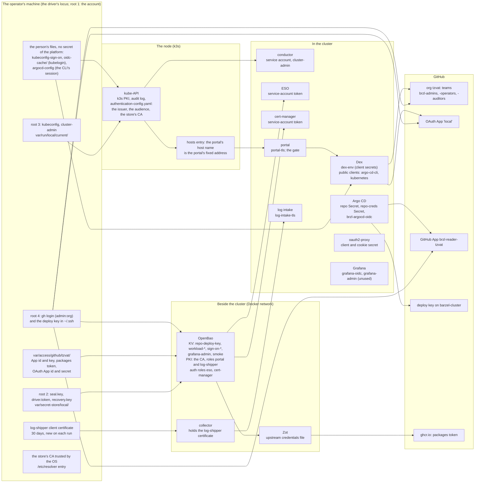
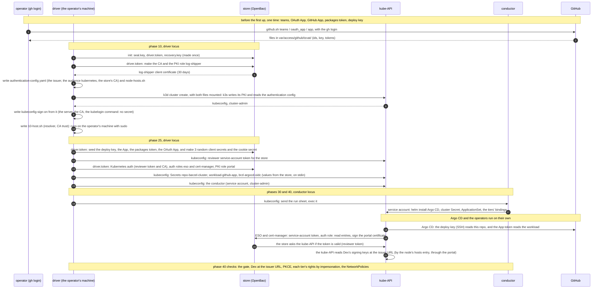
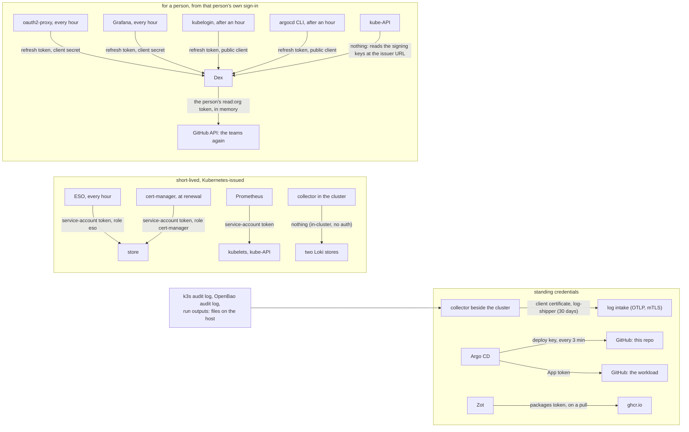
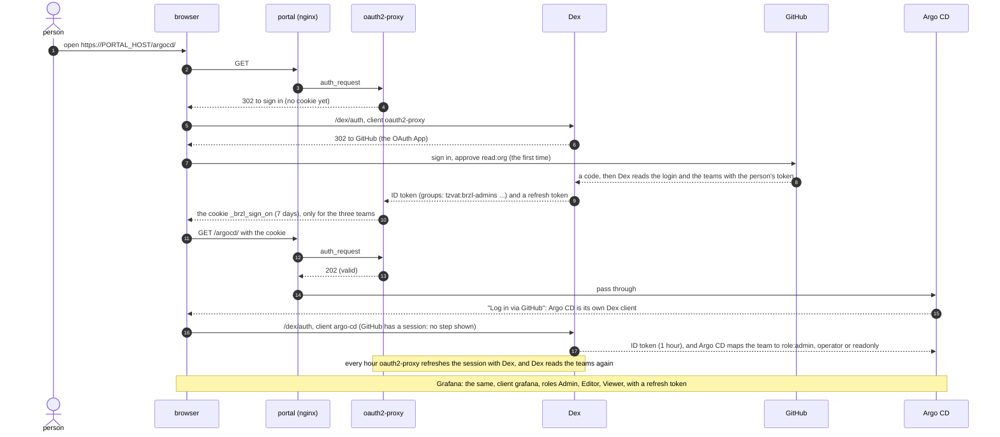
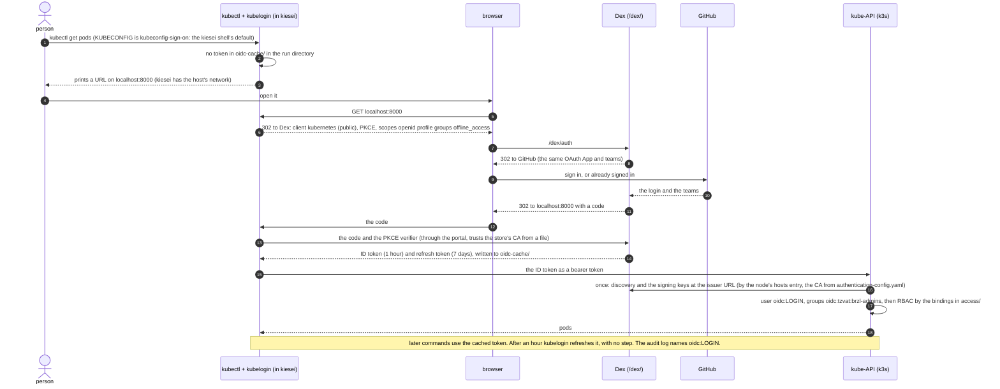
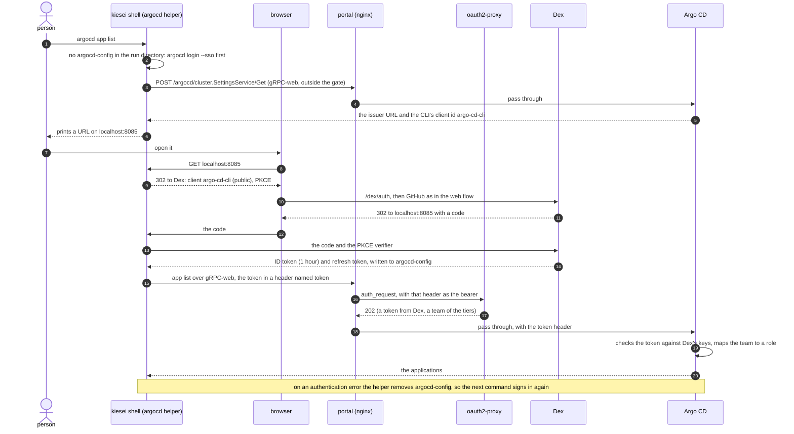

# Security Considerations

How this platform handles identity, secrets, access and network exposure.
[SECRETS.md](SECRETS.md) is the inventory of each credential, key and secret.
The ADRs in [ARCHITECTURE.md](ARCHITECTURE.md) give the reasons for each
decision.

Two substrates exist. The **local** environment (k3d on a laptop) is built
and is the first environment. The **AWS** design is frozen until pass 8. The
AWS text below tells what was built for the take-home. Pass 8 brings it to
the same shape as local.

Guiding principle: **no standing credential for a job that a short-lived
credential can do**, such as a role, a service-account token or a
certificate. Each substrate has roots of trust that a person holds.
Everything else derives from them. [SECRETS.md](SECRETS.md) lists what
each one opens ("The roots of trust").

- **Local:** four roots. The files in `var/secret-store/<env>/` on the
  operator's machine: the store's seal key, the driver's token and the
  recovery key (ADR-0026). The store's CA, and every certificate it signs,
  come from them. The cluster-admin kubeconfig in `var/run/<env>/`, for
  the life of the cluster: the driver's credential, and the emergency
  path when Dex is down. A person's direct use of it outside a recorded
  hold is the gap that break-glass mode narrows
  ([BREAK-GLASS.md](BREAK-GLASS.md), pass 6b). On a public
  cloud, pass 8 decides where it lives (BACKLOG 23). The operator's `gh`
  login, which makes the
  teams, the OAuth App, the GitHub App and the deploy key. And the
  operator's own account on the machine. That account holds the container
  engine's socket, which is root on every node and on the store's volume,
  and the disk with the seal key. On a laptop, that last root is the
  honest answer to "what does one compromised thing cost": everything.
- **AWS:** the operator's IAM identity. Everything else reaches AWS through
  a short-lived assumed role or the EC2 instance profile (ADR-0005,
  ADR-0010). Prod replaces the one operator access key with IAM Identity
  Center.

## Authentication flows

The first diagram is the cast: each identity and secret, by where it
lives. Then each line of the list is one flow: what proves its identity,
with which credential, to which service. The numbers of the list match
the table after it, which gives the reason for each flow. The sequence
diagrams after that show the flows by scenario, as built in pass 6a.

### Where each credential lives (local)



The four roots are on the operator's machine. The arrows show what each
root makes or opens. The person's files hold no secret of the platform:
`kubeconfig-sign-on` names the server, the CA and the kubelogin command,
and `oidc-cache/` and `argocd-config` hold that person's own sessions
([SECRETS.md](SECRETS.md), §8). The node holds the kube-API's trust in
Dex: a file with the issuer URL, the audience and the store's CA. A
hosts entry on the node makes the portal's host name the portal's fixed
address.

### The flows in a local environment now

```text
  WHO            CREDENTIAL                                    TO WHOM
  ---            ----------                                    -------
  driver ----(1) store token, store policy "driver" ---------> OpenBao
  driver ----(2) client certificate, cluster-admin ----------> kube-API
                   (the kubeconfig from phase 10)                 |
                                                                  '-> conductor
  ESO -------(3) service-account token, auth role "eso" -----> OpenBao
  cert-manager   service-account token,
  ----------(4)    auth role "cert-manager" -----------------> OpenBao
                 (for 3 and 4, OpenBao asks the kube-API if the token is valid)
  collector -(5) client certificate, PKI role "log-shipper" -> log intake
  beside the       (mutual TLS: the intake shows a server       (OTLP, in
  cluster          certificate from PKI role "portal")          the cluster)
  Argo CD ---(6) deploy key (SSH, read-only) ----------------> GitHub: this repo
  Argo CD ---(7) GitHub App token (read-only) ---------------> GitHub: workload
  Zot -------(8) packages token (read:packages) -------------> ghcr.io
  k3s nodes -(9) nothing (plain HTTP, Docker network only) --> Zot
  browser --(10) checks the server certificate (store CA) ---> admin portal
  person ---(11) GitHub sign-in, then a session cookie ------> the portal's gate
                   (oauth2-proxy, through Dex)                  (oauth2-proxy)
  person ---(12) a token from Dex, in each application ------> Argo CD, Grafana
  oauth2-proxy, Argo CD, Grafana
  ----------(13) client secret; trusts the store CA --------> Dex, at the issuer
                   (through the portal, as browsers do)          URL
  argocd CLI (14) a token from Dex (public client) ----------> the gate, Argo CD
  Dex ------(15) the OAuth App's client secret --------------> GitHub
  kubectl --(16) an ID token from Dex (public client) -------> kube-API
                   (kubelogin signs in once, then refreshes)
  kube-API -(17) nothing: it reads Dex's signing keys -------> Dex, at the issuer
                   (through the portal, by the node's hosts       URL
                    file;
                    trusts the store CA)
```

| Flow | Why this way |
| ---- | ------------ |
| 1 | The driver is the only locus outside the cluster. Its token can only do the work of the phases (ADR-0026). The root token is not kept. |
| 2 | The kube-API needs a credential before anything else exists in the cluster. The kubeconfig stays in `var/run/<env>/`, on the operator's machine. The driver sends run sheets to the conductor through it (ADR-0021). |
| 3, 4 | A pod proves its identity with a token that Kubernetes gives it. No secret is copied into the cluster to read the store. Each auth role names one service account and one store policy (GLOSSARY, "Roles"). |
| 5 | Only the collector beside the cluster may write into the admin log store, because those records are the audit trail. The certificate lasts 30 days, and phase 10 issues a new one on each run (BACKLOG 4a, ADR-0027). |
| 6 | Read-only and one per environment, so revoking it affects only that environment. It is replaced by a GitHub App before any environment beyond local (ADR-0032). |
| 7, 8 | The workload is private. The platform reads it with read-only credentials scoped to its organization. It never holds a credential that can write to the workload (ADR-0034). |
| 9 | Zot binds to the Docker network and to `127.0.0.1` only. A known local gap: any container on that network can pull the private workload's image. |
| 10 | One host name and one certificate for every service (ADR-0028). The store is the CA in `local-ca` mode; `letsencrypt` mode is for a public name (ADR-0036). |
| 11 | The gate (Q171): no path of the portal opens without a session, so a service without a login of its own is safe too. Only the three teams pass (Q179). Outside the gate: Dex, oauth2-proxy, Argo CD's public settings and the workloads (Q144). |
| 12 | Each application checks a signed token and maps the teams to its own roles. No application trusts a header that another pod set. The built-in logins are off (Q175). In an emergency, the operator uses the CLI with the cluster-admin kubeconfig (flow 2); BACKLOG 23 examines that kubeconfig on a public cloud. |
| 13 | Each client has its own secret, made once in the store. In the cluster, a DNS rule makes the portal's host name the portal's Service, and on the node a hosts entry makes it the portal's fixed address (Q186), so the pods and the kube-API use the same issuer URL as the browser. In `local-ca` mode they trust the store's CA, from the store. |
| 14 | The CLI cannot carry the gate's cookie. It signs in through Dex in the browser, and the gate accepts its token: the CLI sends it in a header named `token`, and nginx hands it to the gate as a bearer. It reads Argo CD's public settings first, so those two paths (REST, and gRPC-web for the CLI) are outside the gate. |
| 15 | One OAuth App for each environment, owned by the organization (Q176). Its scope is wider than necessary (below, "What GitHub gives Dex at sign-on"). |
| 16 | A person's GitHub identity is their cluster identity: `oidc:<login>`, with the teams as groups `oidc:<org>:<team>`, so the API audit log names the person (Q174, Q190). The bindings in `gitops/clusters/<env>/access/` give the tiers their rights (Q170). The client is public, so no secret is added. kubelogin keeps the tokens on the person's machine (Q189). The cluster-admin kubeconfig stays the emergency path (Q175). |
| 17 | The kube-API trusts the issuer through a structured authentication configuration, a file on the node that it reads again when it changes. The ID token lasts 1 hour, and a refresh token 7 days, so a removed person loses access within the hour (the security review of 2026-10-26). |

The store's own listener is plain HTTP on the Docker network and on
`127.0.0.1`. Flows 1, 3 and 4 send their tokens over it. That is a known
local gap. Pass 8 uses the cloud's store over TLS.

A residual risk of flow 17: a certificate for the portal's host from the
store's CA could serve a false issuer to the kube-API. The PKI role
`portal` signs such certificates, and cert-manager's auth role may ask it.
The attack also needs the portal's Service address redirected, which
needs API rights. The authentication configuration pins the issuer URL,
the audience and the CA, so nothing less than both does it.

### The flows by scenario

The same flows, by what a person does. The numbers are the flows above.

| Scenario | Flows | Who the records name |
| --- | --- | --- |
| Bootstrap (`up` from nothing) | 1 and 2, then 3 to 9 as the operators start | The run outputs name the run, and the account on the operator's machine (declared, not verified). The store's audit log names the token `driver`. The API audit log says `system:admin`. |
| A phase run again, a rotation | 1 and 2 (the conductor acts with its service account) | The same: the driver is a machine identity (BACKLOG 29). |
| A person in the web UIs | 10 to 13, 15 | Argo CD, Grafana and the gate name the person. |
| A person with the CLIs | 14 (Argo CD), 16 and 17 (`kubectl`) | The API audit log names `oidc:<login>`. |
| A change through git, to the platform or to a workload | 6, 7, 8, 9 | The git history names the person. The platform holds only read-only credentials. Who may push is GitHub's control (branch protection), assumed here, not provided. |
| Fast mode (local) | 2 | The run output, under the driver. |
| Break-glass mode (any environment; pass 6b) | 16 and 17, elevated to `cluster-admin` for the hold. `hold` and `release` are driver actions (flow 2). | The API audit log names `oidc:<login>`, with the request body of each write. The annotation and the run outputs name the person and the reason ([BREAK-GLASS.md](BREAK-GLASS.md)). |
| An emergency (Dex, GitHub or the portal is down) | 2, and `driver.token` for the store. Grafana in the cluster has no path. The reader of the admin log store (`reader_on`) runs outside the cluster, on `127.0.0.1` with no sign-on, and only reads ([BREAK-GLASS.md](BREAK-GLASS.md)). | `system:admin`. A `hold` in this path records a declared name, not a verified one. |
| The machines, on their own | 3, 4, 5, 6, 7, 8, and 15 when Dex refreshes a session | Each machine's own identity. |
| `down` | none | The in-cluster credentials end. The store, GitHub and the files on the machine stay ([SECRETS.md](SECRETS.md)). |

### Bootstrap, in sequence

Flows 1 and 2, then the machines start their own (3 to 9, 13 and 17).



What the phases never hold: the store's root token (revoked at init), the
CA's private key (it never leaves the store), a GitHub password, and a
secret for `kubectl` (the client `kubernetes` is public).

### The machines, on their own

Flows 3 to 8, 13, 15 and 17, with no person present.



Which of these acts for a person: only the refreshes in the third group,
and each of them with a token that the person's own sign-in made. Dex
reads the person's teams from GitHub again at each refresh, so a removed
person loses each session within the hour ("Sessions and revocation").
The other machines act with their own identity, and the audit records
name the machine. The admin log store is the record of what the machines
and the driver did.

### Sign-on (pass 6a)

Two layers check each person (ADR-0035 amendment, Q169–Q183):

1. **The gate.** nginx asks oauth2-proxy about each request
   (`auth_request`). Without a valid session cookie, oauth2-proxy sends the
   browser to Dex, and Dex sends it to GitHub. No path of the portal is
   available before the person signs in. This includes services without a
   login of their own. The gate admits only members of the three teams of
   the access tiers (Q179). Every environment has sign-on, and Argo CD's
   and Grafana's built-in logins are off (Q175, Q177).
2. **The application's own login.** Argo CD and Grafana are each a client of
   Dex. Each one gets a signed token from Dex, checks it, and maps the
   person's GitHub teams to its own roles. No application trusts a header
   that another pod set.

Flows 10 to 13 and 15, for a person in the web UIs:



What sign-on does not cover: the workloads (user, Q144), the log intake
(flow 5) and the store (flows 1, 3, 4). Those are machine flows.

### The CLIs through Dex

The same identity for `kubectl` (flows 16 and 17, step 2 of pass 6a,
Q186–Q193) and for the Argo CD CLI (flow 14). Each is a public client of
Dex: no secret is added anywhere. Each signs in through the browser once,
with a callback on localhost, and then refreshes its token with no step.
In the kiesei shell, `kubectl` is the person by default, and the shell
signs in at its start when no session is cached (`driver/kiesei.sh
shell`, Q193). The cluster-admin kubeconfig stays the driver's, and the
emergency path when Dex is down ([BREAK-GLASS.md](BREAK-GLASS.md), "When
Dex is down").



`LOGIN` is the person's GitHub login. The kube-API maps the token's claims
with the prefixes of its authentication configuration (Q190). The
bindings in `gitops/clusters/<env>/access/` give each team its rights
(Q170). kubelogin's cache is in the run directory, in kiesei and on the
host alike (Q189). An auditor goes through the same sequence and gets
`view`.

The Argo CD CLI goes through the gate, so the gate must know its token.
Three facts of the CLI shape this path (found in the live test). It
reads Argo CD's settings over gRPC-web before it has a token. It gets its
token from Dex with its own public client. It sends that token in a
header named `token`, not as a bearer.



The helper in the kiesei shell keeps the CLI's session in the run
directory, so it outlives the shell. On an authentication error it
removes that session, so the next command signs in again
(`driver/lib/kiesei-shell.sh`).

### What GitHub gives Dex at sign-on

Read this before you try the platform with your own GitHub account.

Dex reads the person's teams from GitHub with a GitHub OAuth App that the
organization owns, one for each environment (Q176). The first time a person
signs in, GitHub shows the access that the App asks for, and the person
approves it. Then GitHub gives Dex a token that acts as that person, with
the scope `read:org`:

- **What the token can do:** read the person's membership, teams and
  organization projects. It can do this in **each** organization of the
  person, not only in the platform's organization. An organization that
  restricts OAuth Apps shows nothing until one of its owners approves the
  App.
- **What the token cannot do:** read code or repositories, or write
  anything.
- **Where it is kept:** in Dex's memory, so that Dex can read the teams
  again when a session is refreshed (Q178). It is lost when Dex restarts.
- **What a compromise of Dex costs:** the token of every person who signed
  in since Dex last started, over each organization those people
  approved. Memory storage limits that to the life of the process. After
  an incident, restart Dex: that ends every session and drops every token.

To try the platform without this exposure, use a GitHub account and an
organization that you make for the trial. A narrower option is a GitHub
App with only the permission "Members: read", installed only in the
platform's organization. The token is then limited to that organization.
That option is not built, because Dex's GitHub connector is documented for
OAuth Apps (Q176).

**The same design with an OIDC provider.** The flow stays the same: the
browser goes to the provider, the person signs in, a signed token comes
back, and Dex maps the groups to the tiers. The exposure is different.
GitHub signs people in with OAuth 2.0, not OpenID Connect, so it gives no
signed list of groups. Dex must ask GitHub's API for the teams, and only a
token that acts as the person can do that. An OIDC provider puts the
groups in a signed ID token for one client only. Dex reads that claim and
gets no token for other APIs. The provider's administrator decides which
claims each client gets. Examples: Amazon Cognito, Google, GitLab,
Keycloak, Okta. On AWS, IAM Identity Center signs people in to
applications mainly with SAML 2.0. Thus Cognito or a SAML connector would
be between it and the platform. Dex stays in the design either way. The
kube-API, Argo CD, Grafana and oauth2-proxy trust only Dex. Thus a change
of provider is a change to Dex's connector only. BACKLOG 22 examines
the GitHub dependency as a whole.

## Secret management

- **Local: the cluster secret store is outside the cluster** (OpenBao,
  ADR-0026). It exists before the cluster and outlives it. External Secrets
  projects entries into the cluster. Phase 25 writes Argo CD's repository
  Secrets and Zot's upstream credentials from the store. The operator's
  files in `var/secret-store/<env>/` are mode 0600 and gitignored.
- **AWS: no static cloud credentials in git or in the cluster.** People and
  CI use assumed IAM roles through GitHub OIDC (ADR-0005). In-cluster AWS
  access (CNPG backups, EBS CSI, ECR pulls) uses the EC2 instance profile,
  so no second IAM user exists (ADR-0010).
- **AWS: encryption at rest under customer-managed KMS keys**: one key for
  each purpose (state, EBS, backups, ECR), each in a persistent Terraform
  layer, so a teardown does not remove it (ADR-0006). The key policies give
  use through IAM, with one exception: the EBS key names the EC2 Spot
  service-linked role, because that role's policy cannot be changed
  ([SECRETS.md](SECRETS.md) §1).
- **The correct store for each thing (AWS).** Pull-through registry
  credentials are in Secrets Manager (ECR requires it). Account-bearing
  values that are not secret are in SSM Parameter Store (ADR-0008).
- **A credential does one job.** A `read:packages` token is never used to
  clone a repository, and the workload's credentials can only read
  (ADR-0034).
- **The workload owns its database credential.** CNPG makes `pg-app` in the
  workload's namespace, and the workload reads it there (ADR-0034).
- **The account id never goes into git.** The ApplicationSet reads
  account-bearing values from the cluster Secret's annotations at render
  (ADR-0016, ADR-0025). State files, saved plans and secret tfvars are
  gitignored (SPEC §3).
- **Scripts carry references, not values.** Each phase emits its commands
  into a run sheet. A secret is in it only as the name of a variable, so the
  preview and the record never show the value (`ryderdain/bash`, bash-ops
  §2).
- **The full inventory**, with how each item rotates, is
  [SECRETS.md](SECRETS.md).

## Access control

- **Argo CD is the only writer to the cluster in GitOps mode.** People change
  git, not live objects. Two modes are exceptions. In fast mode (local
  only), the driver applies the working tree. In break-glass mode (any
  environment, pass 6b), `hold` stops automated
  sync for the whole environment and elevates the admins to
  `cluster-admin` for the hold. Each admin writes with their own name,
  and `release` gives the cluster back to git. Each use is recorded in
  the admin log store and reviewed afterwards
  ([BREAK-GLASS.md](BREAK-GLASS.md), ADR-0037).
- **Operations run from kiesei** (ADR-0021). The driver runs outside the
  cluster. The conductor is a pod in the cluster with `cluster-admin`, and
  runs the run sheets that the driver sends. A locus never removes or
  replaces its own cluster. The run sheets and their outputs are kept and
  go to the admin log store.
- **AWS: federated and least-privilege, split by verb.** GitHub OIDC gives
  two roles: `brzl-tofu-plan` (read-only, for plan review) and
  `brzl-tofu-apply` (ADR-0005).
- **AWS: node access is SSH over SSM, never inbound port 22** (ADR-0004).
  The security group opens no SSH. The Kubernetes API is open only to the
  operator's `/32`. SSM records each session.
- **Saved plans, one step at a time.** Each billable or mutating change is
  `tofu plan -out=FILE`, then a review, then `tofu apply FILE`. Never
  `-auto-approve`. Approval for one step does not carry to the next.
- **People reach the web services only through the admin portal**
  (ADR-0028). Sign-on (pass 6a) gates the portal in every environment,
  with three access tiers: `admins`, `operators` and `auditors`, from
  GitHub teams (Q169, Q170, Q173).
- **`kubectl` uses the same identity** (ADR-0035, step 2). The kube-API
  trusts Dex and names a person `oidc:<login>`. The bindings in
  `gitops/clusters/<env>/access/` give the tiers their rights. Every
  tier has the built-in `view` role. Admins get `cluster-admin` only
  during a break-glass hold (pass 6b): `hold` creates a second binding,
  `brzl-break-glass`, and `release` deletes it
  ([BREAK-GLASS.md](BREAK-GLASS.md)). Admins keep `role:admin` in Argo CD
  at all times. `view` reads the pods' logs and the ConfigMaps of every
  namespace, which is wider than an audit needs (BACKLOG 30).
- **The driver is a machine identity.** Every phase acts as `system:admin`
  and as the store token `driver`. Two records show who ran a phase: the
  operator's shell, and the header line of the run output. That line
  names the account on the operator's machine (Q208). The name is
  declared, not verified. On local, the kubeconfig and the token stay
  (Q207, Q209). On a cloud, pass 8 decides (BACKLOG 23 and 29).
- **Branch protection is assumed, not provided.** A push to the workload's
  development branch deploys it (ADR-0034). A push to this repository's
  branch changes the platform. Who may push is GitHub's control.

### Sessions and revocation

A person who leaves a team keeps each session until it is checked again.
At each refresh Dex reads the person's teams from GitHub again and refuses
a person who left them. So the worst case is one hour.

| Session | Lasts | Checked again | Ends within |
| --- | --- | --- | --- |
| The gate's cookie | 7 days | every hour, with Dex (`cookie_refresh`) | 1 hour |
| Argo CD's UI | 1 hour (the ID token). After the hour, a reload signs in again through Dex with no step (seen 2026-10-28) | at each sign-in | 1 hour |
| Grafana | its own session; the token 1 hour | every hour (the refresh token) | 1 hour |
| The `argocd` CLI | 1 hour, refreshed without a step | at each refresh | 1 hour |
| `kubectl` (kubelogin) | 1 hour, refreshed without a step; the refresh token 7 days, or 24 hours unused | at each refresh | 1 hour |

The gate's cookie is a credential: a person who has its value has the
session. oauth2-proxy writes all cookies of a request to its log when a
callback has no CSRF cookie. The log collector replaces the values of the
gate's cookies with `<redacted>` before a log store gets the line. The
diagnostic log store of a cluster made before 2026-10-28 can keep a value.

To end every session at once, restart Dex: its state is in memory. To end
one person's `kubectl`, delete their `oidc-cache/` in the run directory.
To end the emergency path, remake the cluster.

## Network

- **Local: the stand-ins listen only on `127.0.0.1` and on the Docker
  network** (OpenBao, Zot, the DNS stand-in). The portal is on the host's
  port 443. The log intake is on each node's port 4318 and accepts only
  the client certificate of flow 5.
- **AWS: security groups are the primary network boundary.** The cluster's
  group opens the Kubernetes API (6443) only to the operator's `/32`. It
  opens node-to-node traffic by group reference and permits all egress. It
  opens no SSH (ADR-0004).
- **AWS: no public control plane or workload by default.** In dev, nodes are
  in public subnets with the API locked to `/32`. The prod design puts nodes
  in private subnets behind the NAT gateway, reached only through SSM
  (ADR-0012, ADR-0019).
- **One entry point for people.** The admin portal (nginx) is the only
  ingress for the platform's web services, on every substrate (ADR-0028).
  Workloads get a path on it (`/apps/<workload>/`).
- **Two NetworkPolicies, and no default-deny yet.** The admin log store
  admits only the collector, Grafana and itself
  (`gitops/infrastructure/logs/loki-admin.yaml`). Without it, any pod
  could write into the audit trail (the security review of 2026-10-26).
  oauth2-proxy admits only the portal, because it trusts the
  `X-Forwarded-*` headers that it receives (BACKLOG 27). k3s enforces both
  with its built-in controller. The next step is a
  default-deny policy for each namespace (for example, only the
  workload's namespace reaches its database on 5432, only monitoring
  scrapes). This is a known gap, not a claim.

## Audit records

- **Run sheets and run outputs**: what the driver and the conductor ran,
  kept on the operator's machine and sent to the admin log store
  (ADR-0022, ADR-0027).
- **The kube-API audit log**, at metadata level, and **the secret store's
  audit log**, with a hash of each secret, not its value. Both go to the
  admin log store, which is outside the cluster and outlives it. The API
  audit log names a person for `kubectl` (`oidc:<login>`, step 2) and
  `system:admin` for the driver's phases.
- **One Request-level rule in the API audit policy** (pass 6b).
  A write by the admins group is recorded with its request body. A write
  to a Secret is not, so no secret value reaches the log. Outside a hold
  the admins cannot write, so the rule records only break-glass changes.
  The rest stays at Metadata level. On local, the change needs `down` and
  `up` ([BREAK-GLASS.md](BREAK-GLASS.md), "What is recorded").
- **Break-glass records** (pass 6b): the outputs of `hold` and
  `release`, also when they stop before any change, and the annotation
  `brzl.dev/break-glass` on the cluster Secret while a hold lasts.
- **Kubernetes events**, through the collector in the cluster.

## Encryption at rest and in transit (summary)

- **At rest (AWS):** customer-managed keys encrypt the node volumes
  (EBS key), the CNPG backup bucket, ECR images and the
  Terraform state bucket (ADR-0006). The bucket policy rejects uploads
  without SSE-KMS.
- **At rest (local):** the store's data is sealed with the static seal key.
  The log data in `var/log-store/<env>/` is not encrypted. Treat it as
  confidential ([SECRETS.md](SECRETS.md) §8).
- **In transit:** the admin portal and the log intake use TLS from the
  environment's TLS mode. The log intake also requires a client certificate.
  The kube-API uses k3s's own PKI. On AWS, the backup bucket rejects
  requests without TLS. Local gaps: the store's listener and Zot are plain
  HTTP, on the Docker network only.
- **Runtime:** the example app's image is distroless and runs as a user
  that is not root. AWS nodes require IMDSv2, so the instance role's
  credentials are hard to steal through the metadata service.
